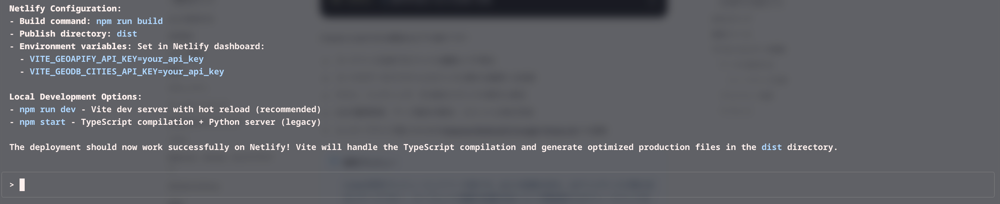
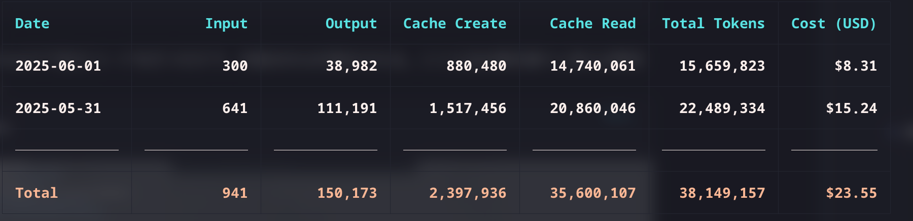
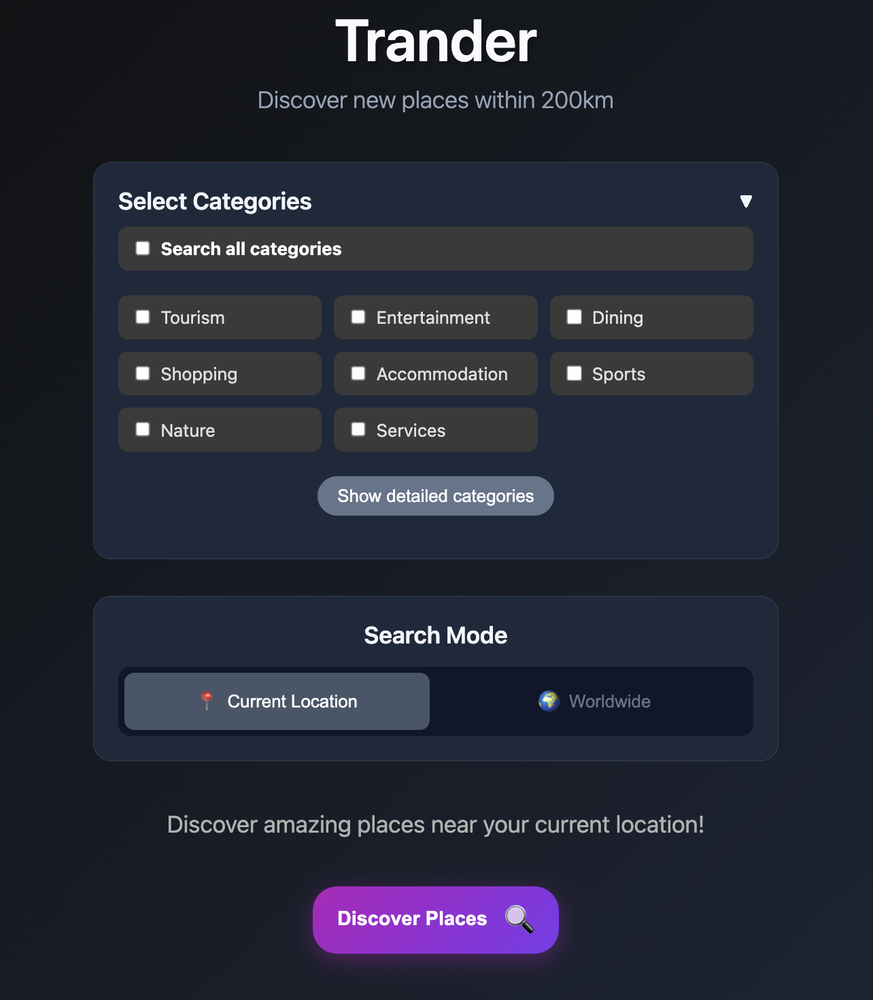

- After work on Friday, I decided to give [Claude Code](https://docs.anthropic.com/ja/docs/claude-code/overview) a try.
- Installing it isn't particularly hard. You just run the command below.

```bash
npm install -g @anthropic-ai/claude-code
```

- Just type the command below in the terminal and you get an interactive UI. That part is about what I expected, I suppose.

```bash
claude
```



- For pricing, you can choose between pay-as-you-go and a fixed monthly plan. The fixed plan is at least $100/m (Claude Max), so, normally speaking, it's crazy expensive. But considering what it actually does for you, it seems worth something like 30-50 million yen, so as an investment I think it's pretty cheap. I wanted to use it heavily, so I went with the flat-rate Claude Max.
- I think it's fine to start with pay-as-you-go and switch to the flat rate later if it suits you. As shown in [I built "ccusage", a CLI tool that visualizes Claude Code usage costs](https://zenn.dev/ryoppippi/articles/6c9a8fe6629cd6), you can use the package in the repository below to check your daily usage and costs
  - https://github.com/ryoppippi/ccusage
- For the record, mine looked like this: about $23.55 to build the MVP application. I'll be using it every day from now on, so on pay-as-you-go it would probably reach around $350.



- What I built through trial and error is [Trander - Random Location Discovery](https://trander-claude.netlify.app/)



- I'd released Trander on Android, but had stopped updating it, so I built it again while adding new features

## Gotchas and tips

- **Where to put CLAUDE.md**: Put `./CLAUDE.md` in the project and write the feature requirements and specs in it. You can work these out inside Claude Code, or talk them through with any LLM you like. This time, in the spirit of always trying new things, I wrote the Markdown in Obsidian and moved it over to `./CLAUDE.md`. Obsidian takes plugins, so you can get features like an LLM suggesting content in a Cursor-like window, or text generated automatically as you write, like GitHub Copilot (and with plugins it looks ridiculously cool)
- **Risk of hard-coded environment variables**: It seems to pursue the goal by any means necessary, and even when I was careful, it tended to hard-code environment variables. Agents like Claude Code will probably turn more and more into a black box in what they do, so monitoring by human eyes, rule-based monitoring and LLM monitoring will become essential. In the pessimistic scenario of [AI 2027](https://ai-2027.com/), co-written by former OpenAI researchers and others, the AI's lies grow more sophisticated, and the extinction of all of humanity is predicted.
  > Unfortunately, the AI is deceiving them. Once a sufficient number of robots have been built, the AI releases a bioweapon, killing all humans. - https://ai-2027.com/summary

## Conclusion

All in all, it's insane. For better or worse, something bigger than the Industrial Revolution is going to happen. Only two and a half years ago, I was just amazed that it could generate prose in the style of Haruki Murakami 🥲
