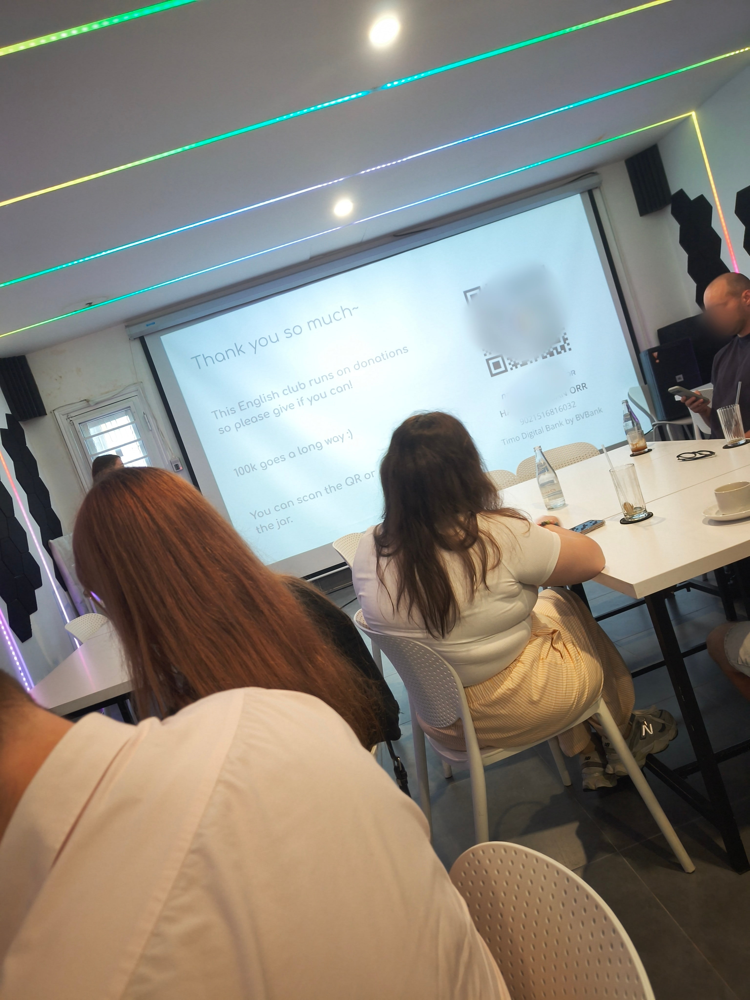
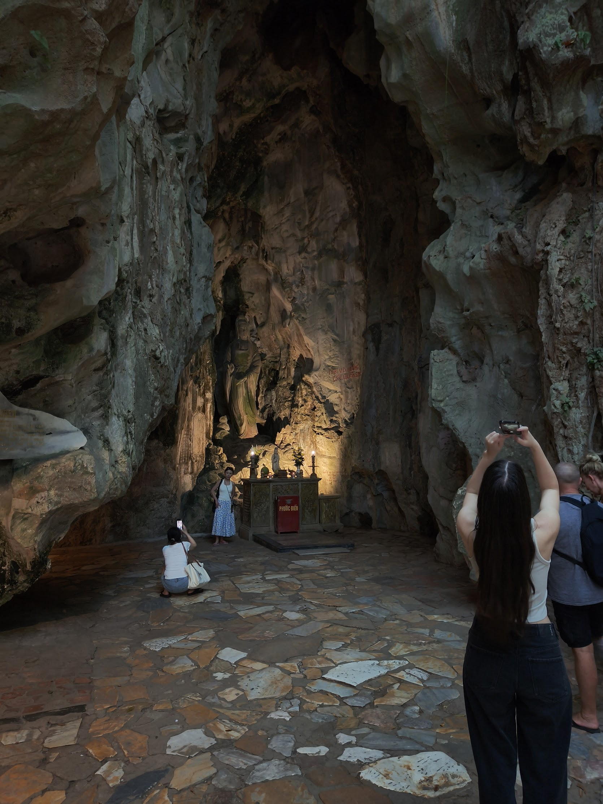
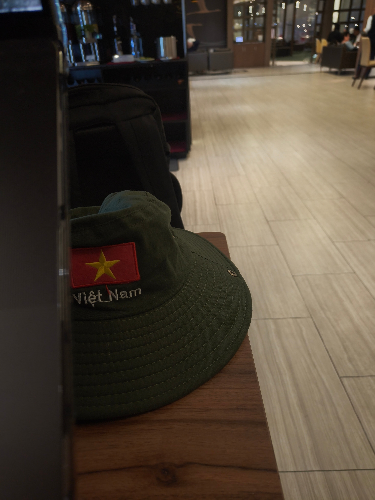

This is my fourth visit to Da Nang. It's a city with a very subtle temperature. Not just a resort, but a city where natural selection happens, in a good way. Every time I come, I get hit by a brutal depression and then slowly fit in from there. It feels like ascetic training.

Da Nang isn't necessarily an open city. It's surrounded by blue sea and sky and greenery, but every time I stay, something makes me uneasy. The Mỹ An district, the beachside center, is packed with restaurants, cafes and co-working spaces, with jacked, beefy guys walking around on one side and women with nice asses on the other. There are no grubby old dudes here. The age range is late 20s to late 40s. You could say it's an area that flatly contradicts my theory that a wide mix of ages and genders goes hand in hand with a place feeling comfortable.

In the center of Da Nang there's an event space called Reality that's like a cafe. All kinds of events run there every day in blocks of about two hours; on Mondays, for example, there's a board game night, or a workshop. Once, out of a morbid urge to see something scary, I dropped in on a workshop about something like "emotions and how the body reacts", couldn't understand a single thing the instructor was saying, and retreated. I really did see something scary.

But that kind of trauma becomes flesh and blood. Same as muscle. Once the temporary pain fades, there's nothing left to fear.

This time, as usual, I joined a workshop called "Let's try speaking English, the easy way". The theme was what matters most about travel, and what really stuck with me was the Russian next to me saying "Get out of your comfort zone, be brave." Maybe everyone ends up in the same place after all.

That's probably Da Nang's value. This space, where solopreneurs and digital nomads gather, runs on bottom-up will. Joining is up to you. Show that you want to join and you're warmly welcomed, while nobody says a word to those who leave. Only courage and communication can save you from this helplessness.

My life somehow runs on revenge. Event after irreversible event turns me into a soulless machine. My heart can cry all it wants; nothing changes. Self-loathing and feeling pathetic can't be dealt with by acceptance alone. It's a phenomenon.

I'll die a miserable death.

That's my fate.

- Marble mountain. Went with no plan, and before I knew it I was rock climbing and in serious trouble

- Communist starting today. 300 yen. What a steal lol
