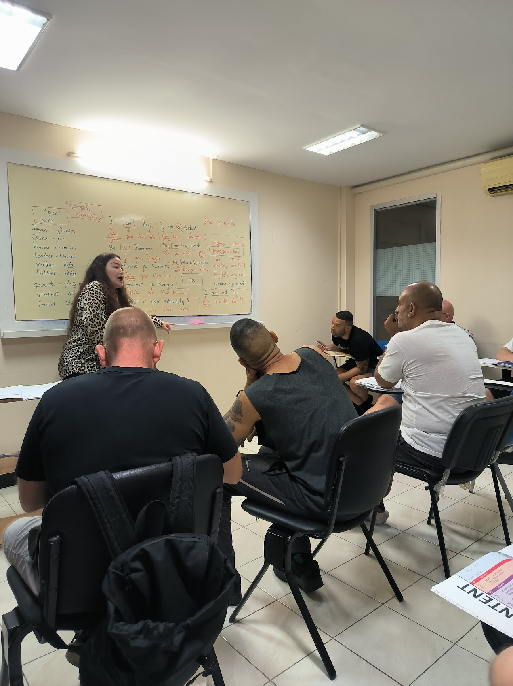
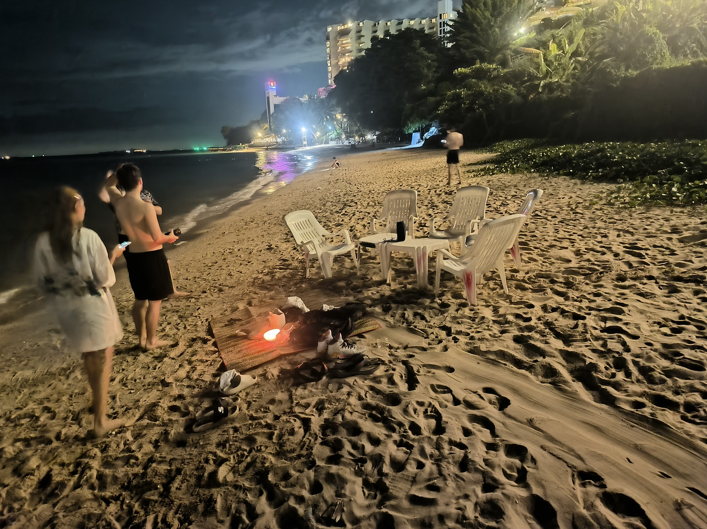
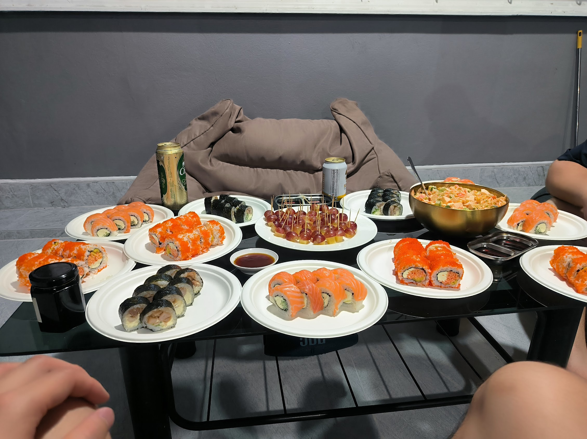
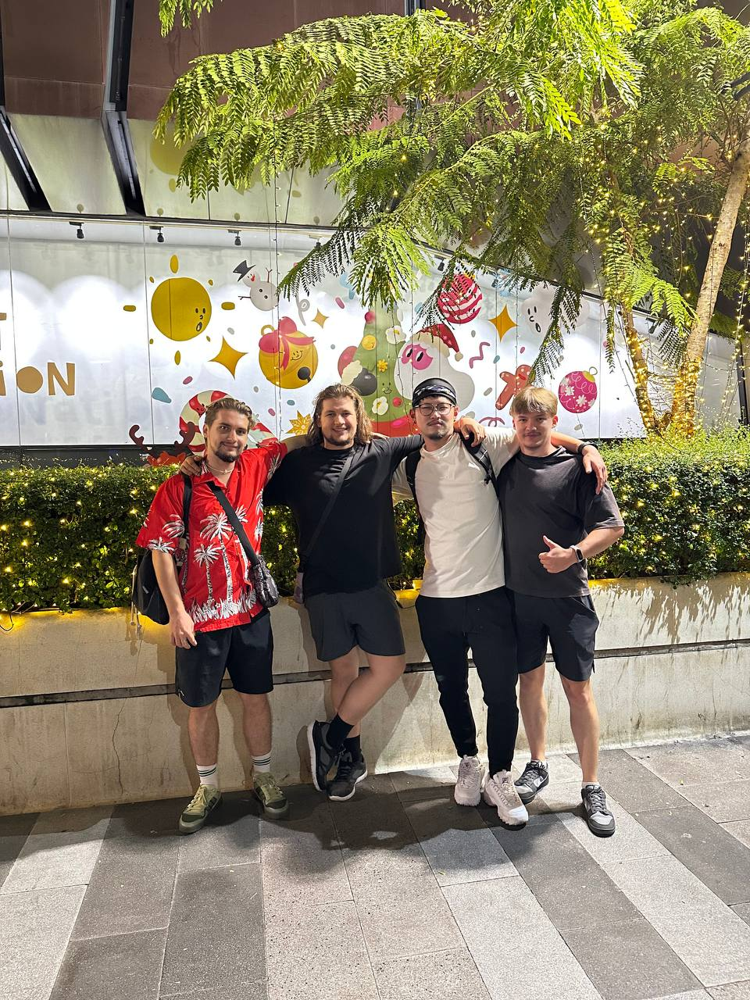

While I was clearing out my things to hand back the room, I had a strange sense of unease. The things I owned were disappearing. How am I supposed to live from here? A vague anxiety quietly spread. I never thought I depended on the stuff in my room. I'd been looking away from leaving the country because I depended on Bangkok.

A year had passed since I moved to Thailand. I got an ED-VISA on the pretext of learning Thai and went to a language school in Pattaya. Classes were all in English, so more often than not I didn't understand the questions or the explanations. I get nervous easily, so every class my Garmin watch kept going off with warnings about an abnormal heart rate.

In the end, the school was the only thing I had to lean on. I think Thailand is an extremely easy country to move to in terms of convenience and cost, but going in on your own is very dangerous. A loneliness you can't get a grip on spreads out endlessly. Loneliness is always resolved by trust. While I was feeling pain and fear, the classes once or twice a week gave me a sense of safety.

Looking back on this year, I can't not name them. The Ukrainians Vitaliy, Dimitri and Oleg. One day after class they reached out a strong hand, and my life changed fast.

Before I knew it, I was tearing around town on a 155cc YAMAHA. I'd never even dreamed of riding a motorcycle, so this was a real bolt from the blue. Raging at the cars and bikes that drifted into the oncoming lane, sped down the sidewalk and relentlessly made dangerous lane changes, I was twisting the throttle right along with them. If they hadn't lent me their bikes to practice on, and hadn't taken me to a used bike shop, I'd surely still be stuck with the inconvenient life of taking songthaews and MBT in the blazing heat.

I've been moved again and again by how fearless and brave they act. I'd felt there were no role models in Japan, where you're expected to be kind to people while holding yourself back. The way they live, chasing strength physically and mentally, gives courage to an empty heart. When I crashed the rental bike I'd borrowed, they stood up to the fully tattooed old guy, definitely a gangster, and argued him down; I'll never forget that as long as I live. And I won't forget how, on our trip to Si racha, they took off at the bikes' top speed and were gone in no time. They're always chasing strength.

And what impresses me is that they never act like hotshots. Like Gian in the Doraemon movies, they're arrogant but still lend you a hand. Granted, they came here to escape the war, but their choice to move abroad together as childhood friends has become one of my new role models.

The "real" sushi they served at a birthday party, the barbecue meat, and the olivier salad, a potato salad loaded with chicken, were all weirdly delicious, and their actions are weirdly convincing. I'd half sensed it, but now that they're gone, I have no strong reason to stay in Thailand. I'd been filling the thinness of my relationships with things. Now is the time to let go.

Of course, it didn't always go well. We moved forward bit by bit, getting through awkward moments over small differences of opinion.

I remember a day in March.

We walked around a pond that had half dried up.

An ordinary pond, for no reason at all.

As if I were doing junior high over again.

