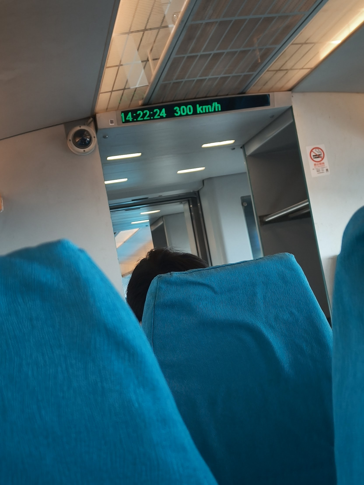
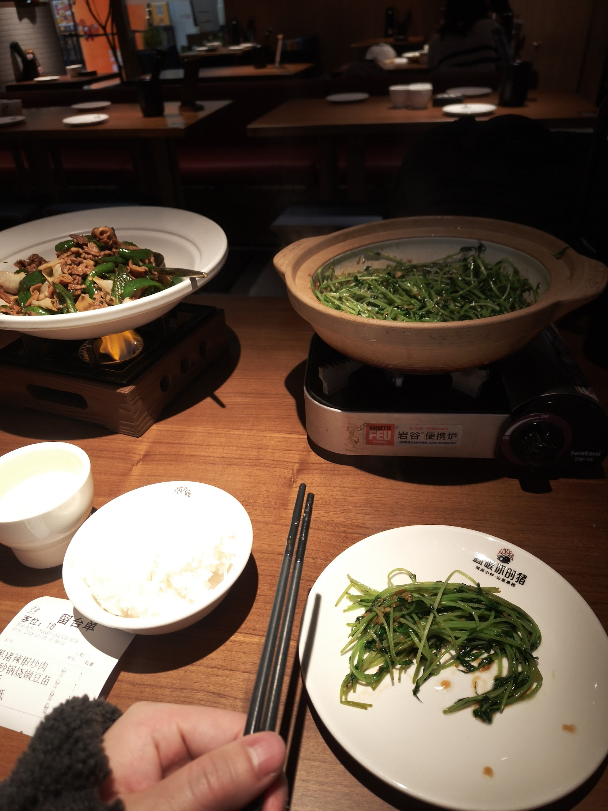
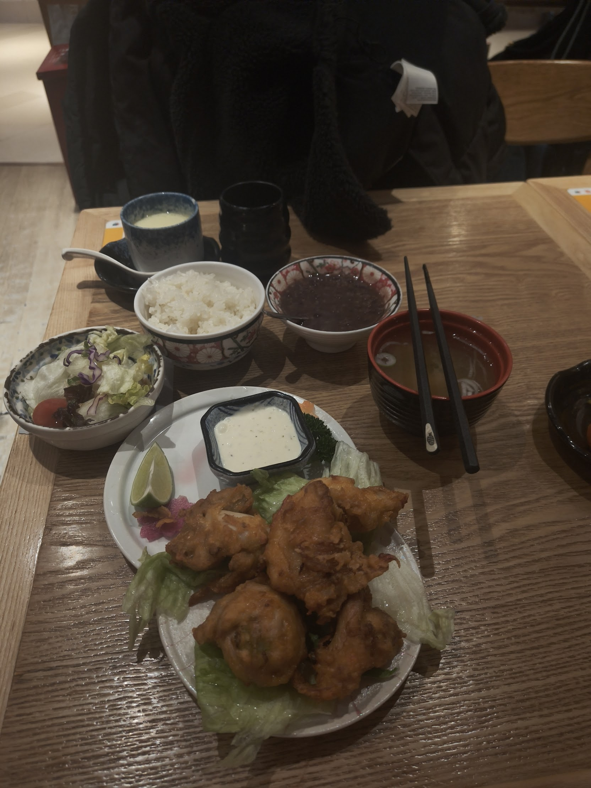
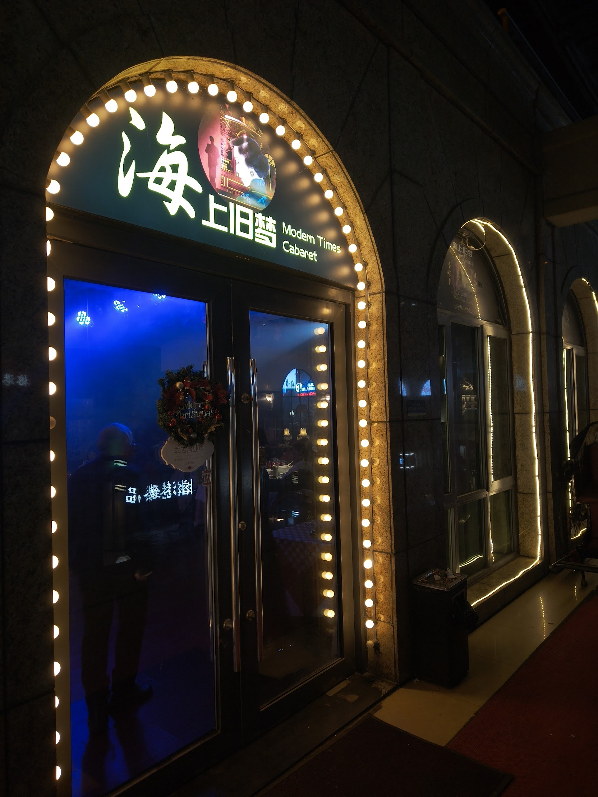
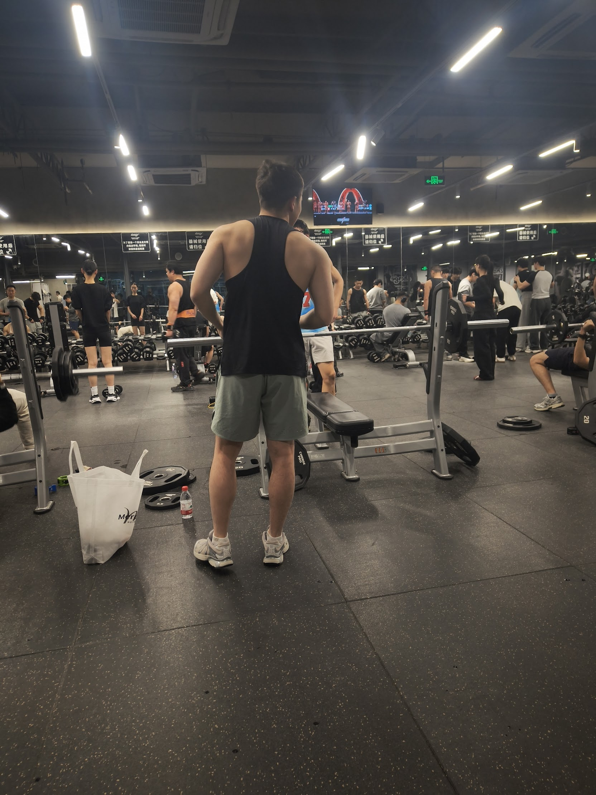
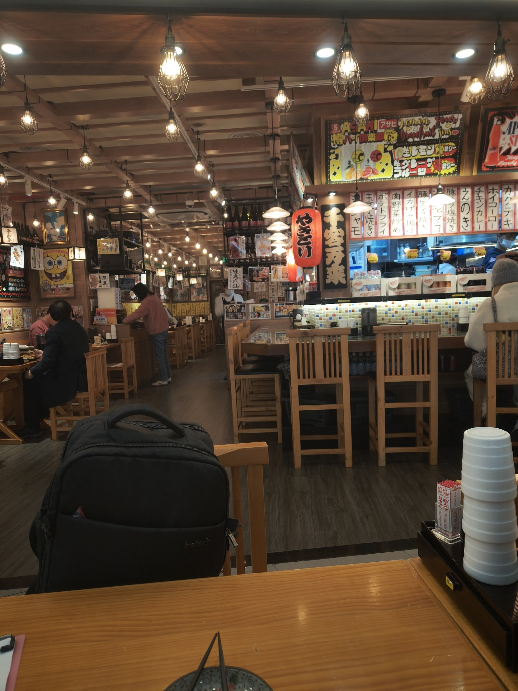
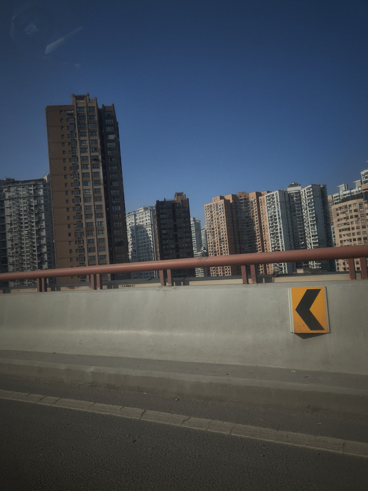
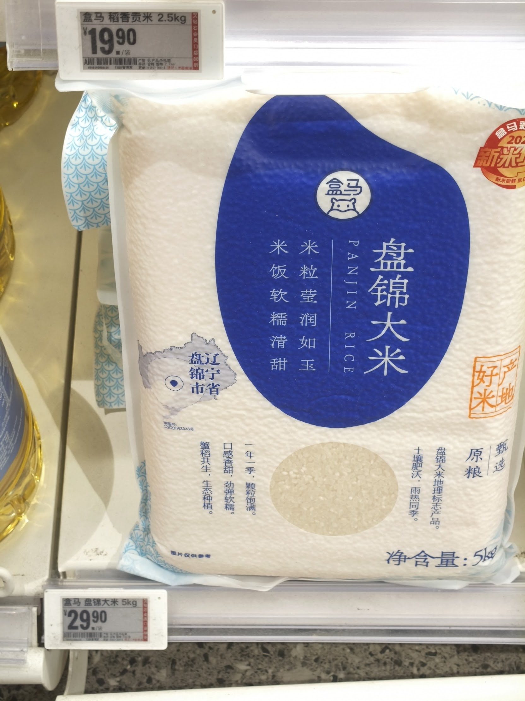

Oh. They suspect me.

"What are you here for?"

"How many days are you staying?"

"Have you been to China before?"

"Is this your first time in Shanghai?"

"Do you speak Chinese?"

"Do you have friends in Shanghai?"

"Where will you go in Shanghai?"

"Do you work?"

"Which company? Tell me."

Pelted with a barrage of questions by an immigration officer giving me a suspicious look, I answered them one by one, pissing myself as usual.

"What if they suspect me of something I didn't do?"

"I really don't want to get locked up before I've even entered the country."

"What if there's something dodgy on my phone?"

Thinking all that while feigning calm and answering flatly is my duty as a gentleman. Today I shall play a James Bond with a shaky voice. Here's checkmate to your eyes, kid, and my heart's out for the count.

Realizing I was just an idiot, the immigration officer handed my passport back without a word. Entry complete, first mission complete. Now, here's where the problems start. What to eat for dinner, how to get to where I'm staying. Everything is an unknown, after all. This massive-ass city, 2.89 times the size of Tokyo, doesn't allow Google searches. AMAP (高徳地図), Baidu Maps (百度地図), WeChat (微信) and Alipay (支付宝) hold my fate in their hands. Hands are for shaping sushi. Keep them off my fate.

So, on a whim, I hopped on the linear motor car that runs straight from the airport, the "**Shanghai maglev train**". A crazy piece of public transport that covers the roughly 30 km from the airport to the city at up to 300 km/h. About 8 minutes to arrive. You can practically feel the excited snorting of some senior government official who wanted to try running it on a short stretch as an experiment.

It was apparently a novelty for the other passengers too, and once it passed about 300 km/h, people kept pulling out their cameras and snapping away.

## Prices are fairly cheap, despite the reputation

I'd imagined Shanghai as very expensive, but my impression is that it actually isn't that expensive.

- Tokyo >>> Osaka = Sapporo >> Shanghai = Bangkok >>> Da Nang

Shanghai is so huge that I don't really know where to go. When I went to the center, there were tons of really good-looking people walking around, and it gave me a Seoul kind of feeling. I also picked out some cool spots and walked around a bit, but everywhere was crowded or had a line, so I couldn't get into any shop at all. That part feels like Tokyo, and I pretty much hate it. Cities don't have hidden gems. They get found easily and mobbed right away.

But I also found out that all of the above applies only to the center of Shanghai. Shopping malls as huge as spaceships are scattered all over Shanghai, and some are as packed as the front of Shinjuku Alta, while others are as empty as a run-down regional town. Shanghai is really big. I find it fascinating that a shopping mall with LEDs shining like jewels can be deserted.

## Three weeks in, a ridiculously comfortable life

Three weeks after arriving. I realized Shanghai is, in a sense, a city where you can live without communicating. A taxi driver whose destination has been set by DiDi no longer needs to ask where you're going. WeChat and Alipay even erase the hassle of ordering and paying. Technology takes the pain for you, and at the same time blurs the outline of the world outside.

But during this stay, I didn't have a single unpleasant experience.

First, the food is cheap and good. My stay in Chengdu had left me thinking Chinese food was smelly and nasty, but Shanghai proved me wrong in a good way. Subjectively, I'd put eating in Shanghai at around 70-95 points. My rating is based on McDonald's, and a McDonald's burger is about 70-75 points. If a city's food is bad, I go to McDonald's more often, and if it's good, I hardly need to go. This stay, I went only once. There was no reason to go out of my way to McDonald's.

Actually, I could enjoy Japanese food in all kinds of situations too. You can easily find izakaya, independent ones or chains that are close to it, and they taste great, they're cheap, and they're the best. There's Nitori, Sushiro, Hama Sushi, Tsutaya Books, Saizeriya, and on top of that even Gokurakuyu, a giant public bathhouse. Politically the two countries are supposed to be at odds, yet you can live as if you were in a Japanese city. The media doesn't report anything like it, but wouldn't 80-90% of Japanese people say they love it if they lived here? Well, well. Firsthand info is the best!

## Photos that stuck with me

- A restaurant that calls to mind the Taisho era

- Drink this and you win

- You probably can't tell from the photo, but this gym has nobody but strong guys. The good thing about Shanghai is that you can live loosely, but there's a tension here that makes it hard for the weak to walk in

- The izakaya are way too high-res

- Shanghai's scenery is basically centered on gray, so from the outside you can't tell at all what's good about it

- Rice at a little over 600 yen for 5 kg. Seriously cheap. Such abundance

## I hereby declare the Nation of Shanghai

Usually I get bored after a few weeks, but something new keeps sprouting up. Shanghai people are curt but very kind. I don't speak Chinese, so communicating is hard, but they genuinely try to listen. It's as comfortable as being somewhere out in the countryside. There's a Shangri-La here you'd never imagine from the stereotypes.

This isn't China. It's the Nation of Shanghai in China's clothing.
