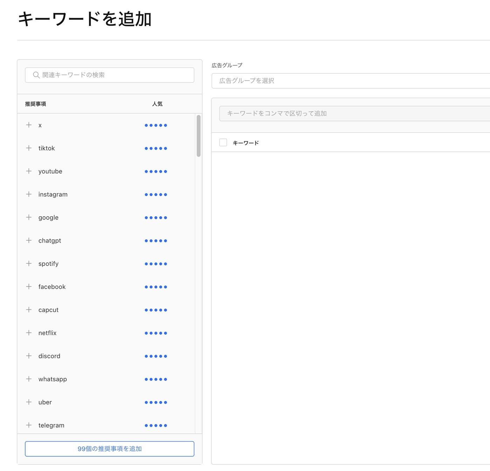
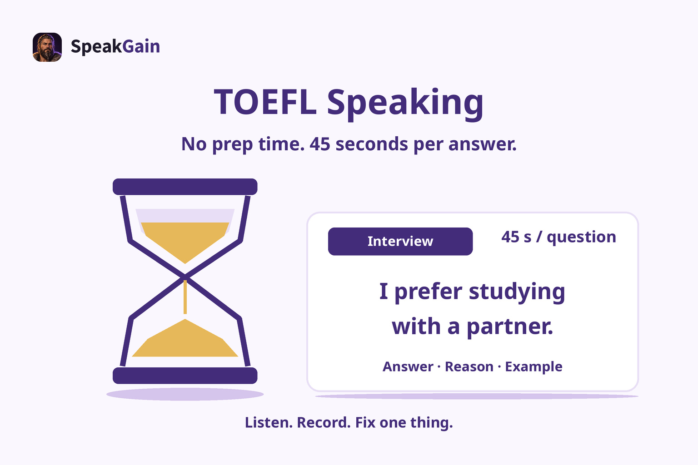
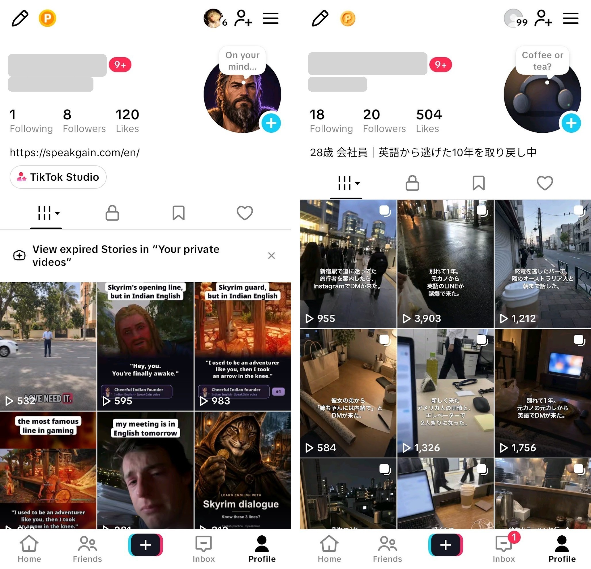

I took the way I've been memorizing English words for several years, turned it into an app, and ran an experiment to see whether it could work as a service. Bottom line: I ended up with only one paying subscriber.

This is a record of what happens when you never put into words where the product should sit, based on an analysis of the competition and the market, what its strengths are against competitors, or which of your users' problems it solves.

## What went well

- uuter, an approach where other agents manage the agentic workflow, raised my productivity a lot
  - In terms of tasks completed, it's 3x what I did before AI (I used to split tasks with a human in mind, so it feels more like 5-10x)
  - I'd like to try [https://github.com/michael-denyer/pstack-claude](https://github.com/michael-denyer/pstack-claude) as an alternative to uuter, but I haven't gotten to it yet.
- People often compliment the design
- Connecting TikTok through a platform called Zernio makes it easy to publish videos
- The setup that keeps new articles coming is ridiculously easy (get keywords from DataForSEO and write related articles).
- I found that CrowdWorks partly works as one acquisition channel
- I found that in Apple Ads, "Add Keywords" (キーワードを追加) tells you how popular the keywords you enter are



- In the Network tab you get a response like the one below, so you can measure popularity more precisely than the five-level rating. Popularity runs from 5 to 100.

```shell
{
    "data": {
        "recommendationV2": {
            "getRecommendedKeywords": [
                {
                    "id": "1",
                    "name": "xxx",
                    "popularity": 5,
                    "matchType": "BROAD",
                    "__typename": "Keyword"
                }
            ],
            "__typename": "RecommendationV2"
        }
    }
}
```

- I made progress on multi-language support, and found that with agents, translation is relatively easy
- I noticed that making the design as an HTML mock and then implementing from that design works, so far.
- With Opus 5.5 and Astra, I got to go through the whole flow from editing a video to publishing it. As long as you have the footage, they edit it with the right effects and cuts. Opus 5.5 felt a little nerfed, though, and raising the agent's effort got output closer to what I'd described in the prompt.
- For AEO or SEO images, have Opus 5.5 or Astra output an SVG and take a screenshot of it, and the result comes out nicely. If you generate images with nothing but Codex's imagegen or ChatGPT's image generation, you seriously get AI slop, so have them build the image out of components in SVG instead. That said, AI generation is handy for characters and backgrounds when you need them.



- I set up Sentry and got to go through the same flow companies use: monitor production → fix the code → submit for review → release
- I released one month after the idea, then, based on how users responded, shipped these fairly large changes in just under two months
  - Adding characters to SpeakGain
  - Dropping the two-week free trial of the paid subscription, and making more of the features usable without logging in
  - Adding a lot more onboarding pages
- That said, you should think about AEO: when a user asks an AI agent "What English vocabulary app do you recommend?", what queries does the AI use to compare apps? It's worth knowing the route an agent takes to compare them.
  1. Search for "best xx app" and collect the list of apps the results recommend
  2. Compare each app from several angles, and suggest the one that fits the user's intent, given the context (reinterpretation)

## What I want to improve

- I didn't see that the market is a game of musical chairs. Search traffic from the App Store or Play Store is one of the big ways to get users, and I never looked at building the app in terms of how to grab one of those seats.


- I never thought about how to stand out from the existing competitors. I figured that making the core a feature Duolingo and ELSA Speak don't offer, "make up your own phrases freely and memorize them by saying them", would give it unique value, but the market has countless competing apps. I never analyzed those competitors to work out whose pain to go after. Not enough analysis.
  - → Which market am I trying to fight in, who dominates it, and which users are struggling with what?
- If I had to name something: it's more efficient to make the shared components themselves in HTML, and implement those shared components
- My motivation died before I'd taken TikTok as far as it could go. I made 45 posts across three accounts (17+18+10), but no rise in app installs ever showed up in the data after posting. I racked my brain over how long to keep posting and what the content should be. As far as TikTok goes, views and engagement are probably what matter, but you need to pull in the interest of the right users. I checked in PostHog: the 45 videos got over 330,000 views, and at most one new user opened SpeakGain. More views isn't the whole point, but I lost track of what to steer by



- I drove development by writing issues, but I didn't look at the implementation much, so there are parts I never put into words. When I haven't put something into words myself, an agent fills it into the issue, or the implementation agent builds something that isn't in the issue at all, and that tends to cause unexpected behavior. Edge cases are exactly where a human should step in, and the moment you leave them alone, the UX tends to die. You don't need to look at the implementation early in development, but sooner or later checking it becomes unavoidable (though I think you could, say, focus only on the places where edge cases tend to come up, like error handling)
- I was weak on how to get it in front of users. I'm confident in the features, but in practice only 0-1 users a day install SpeakGain in the first place. Lowering churn is always a given, but with almost no users to begin with, I kept wondering whether improving it meant anything

## Summary

Basically, not enough analysis. Always be clear about where you're trying to cut in.
