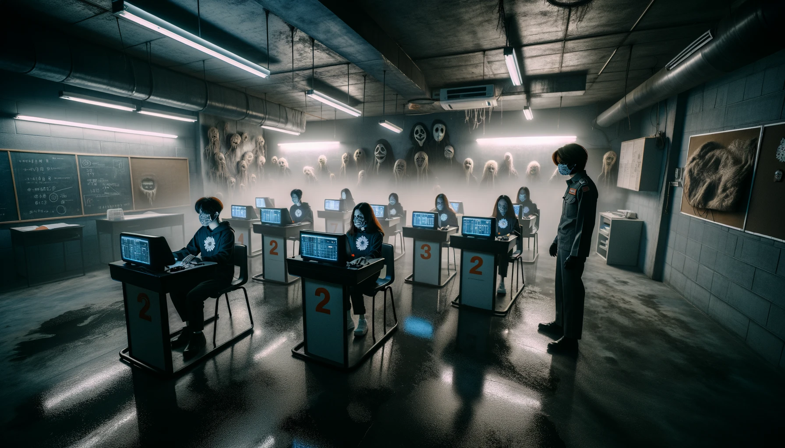
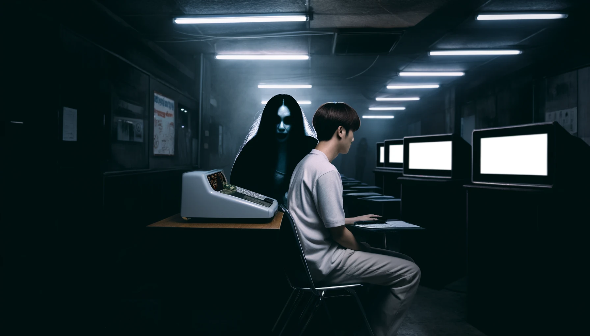

That day, I was meeting A at a coffee shop downtown. It was dim inside, and the retro interior somehow made it feel as if time had stopped. A sat on the leather sofa, staring out the window, her eyes a little distant. The worn old notebook she was holding gave off a faint smell of mold.

I took a sip of coffee and nudged her to talk. "Is there something special about B?"

A was silent for a while. Then she slowly began. "B, you see, actually..." Her voice was low, and trembling a little. "B went to a driving school in Thailand to get a motorcycle license. But..."

Jazz was playing in the shop, but as A's story went on, the music seemed to drift further away. Outside, it started to rain, and the rain beating on the window grew harder and harder.

## A woman's voice

"B went to a driving school in Thailand to get a motorcycle license. But..." A's voice dropped even lower, and the mood in the shop grew heavier still. "The course took two days, and it was all in Thai, so B didn't understand a thing."

I stared at A's face, drawn into her story. The rain outside grew harder and harder. As if to stress that this story was a Pandora's box that must never be opened.

A went on. "The second day was the day of the lecture and the written test. B headed to the driving school feeling uneasy." The mood in the shop was heavy, and the jazz drifted further away. I was completely drawn into A's story.

"The test was in a separate room, and there were six desks lined up facing the wall. Every test-taker was wearing a mask, and you answered on a touchscreen on the desk."

Everyone in masks? Was it a driving school that took COVID measures very seriously? A's voice dropped even lower. "The instructor said, 'You must never turn around during the test,' and 'You must never tell anyone about the test.' B had taken the lectures in Thai, so he had no idea what the answers were, and he was just sitting there in his seat..."

A's face clouded over. "Suddenly, from behind him, he heard a voice: 'No.1... No.3...'"

I was startled and asked back. "He heard a voice? Whose?"

A nodded. "Nobody knows. Maybe B was just hearing things. He said it was a stifled kind of voice. B tried to turn around and check, too. But the instructor's words flashed through his mind, and he was too scared to look back. He pressed the buttons the way the voice told him, and he said the voice sounded like it was whispering right into his ear."

A chill ran down my spine. "So what happened to B?"

A frowned a little as she said it. "In the end, B got 48 points, the passing score. As if that voice had guided him to a pass."

What on earth did it mean? I'm not the type to believe in ghosts. But if nobody was in that classroom besides B, the other students and the instructor, then who fed B the answers? I can no longer smell the rich aroma of the coffee.

"There's more to this story."

A is staring hard at my face.

"After the test, a Thai lady B had gotten friendly with at the driving school came up to him. She'd taken the test in a separate room, but she failed. She said she'd have to take it again."

In other words, the Thai lady hadn't heard any voice. A voice that whispered only to B, the foreigner.

"And then the lady asked how his test went. And B answered, 'Of course I passed. It was super easy.'"
